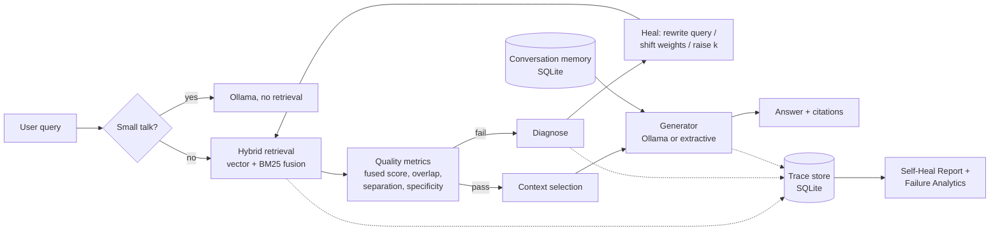

# AdaptiveRAG

[](https://github.com/pravir369/adaptiverag/actions/workflows/ci.yml)
[](LICENSE)

A retrieval-augmented generation (RAG) system that checks its own retrieval before answering, and repairs the query when retrieval looks weak. It runs fully offline: FastAPI + React, SQLite, optional local LLM through Ollama, no API keys.

<!-- Demo GIF goes here: docs/demo.gif (a vague query being repaired, then the Self-Heal Report). -->

## The problem

Most RAG pipelines are `embed -> retrieve top k -> generate`. When retrieval misses, nothing notices: the model gets the wrong chunks and answers confidently anyway. The usual culprits are vague questions ("summarize this"), wording that doesn't match the document, and a ranking where the right chunk sits just below the cut.

## What AdaptiveRAG does

1. **Hybrid retrieval.** Vector similarity and BM25 scores are fused with configurable weights.
2. **Retrieval quality checks.** Every attempt is scored on top fused score, query/chunk term overlap, score separation and query specificity.
3. **Diagnosis and repair.** If a check fails, it labels the failure (`QUERY_TOO_VAGUE`, `RETRIEVAL_MISS`, `RANKING_WEAK`, `CHUNK_TOO_COARSE`, `CHUNK_TOO_THIN`), then tries a fix: several query rewrites scored against each other, a lexical/vector weight shift, or a larger k. It keeps the best attempt.
4. **Grounded answers with citations.** A local LLM (Ollama) answers only from the selected chunks, or a deterministic extractive answer is used when no LLM is available.
5. **Traces for every query.** Each attempt, diagnosis, rewrite score and metric delta is stored, and the UI shows it as a Self-Heal Report plus a failure analytics dashboard.

## Architecture



## Quick start

Needs Python 3.11+ and Node 18+. Ollama is optional.

```bash
# backend
cd backend
python -m venv .venv && source .venv/bin/activate
pip install -r requirements.txt
cp .env.example .env
uvicorn app.main:app --reload --port 8000
```

```bash
# frontend, in a second terminal
cd frontend
npm install
npm run dev
```

Open http://localhost:5173, ingest a `.txt`, `.md` or `.json` file, and ask a question. Or try it from the terminal:

```bash
curl -F file=@backend/eval/corpus/shutil.rmtree.txt localhost:8000/api/ingest/upload
curl -X POST localhost:8000/api/chat -H 'content-type: application/json' \
     -d '{"query": "How do I delete a directory and everything inside it?"}'
```

**With a local LLM:** install [Ollama](https://ollama.com/download), run `ollama pull qwen2.5:3b` (8 GB RAM) or `llama3.1:8b` (16 GB+), and set `GENERATION_PROVIDER=ollama` in `backend/.env`. If Ollama is unreachable, answers fall back to extractive and the UI says so.

`./start.sh` starts Ollama (if installed), the backend and the frontend together.

## Results

Measured with the offline eval in [`backend/eval/`](backend/eval/), which anyone can rerun:

```bash
cd backend && pip install -r requirements-dev.txt
python eval/run_eval.py
```

**Setup.** 33 documents (Python standard-library docstrings for functions like `json.dumps`, `shutil.rmtree`, `subprocess.run`; 40 chunks) and 42 hand-written questions: 28 paraphrased so they share few words with the answer, 14 that use the doc's own terms. Hit@k means the right document is among the first k distinct documents retrieved. Default hash embeddings, extractive generator, top_k=12. Latency is retrieval only, in process, measured once on a cloud VM.

| Retrieval | Hit@1 | Hit@5 | MRR@10 | Hit@1, paraphrased only | p50 latency |
|---|---|---|---|---|---|
| BM25 only | 0.76 | 0.95 | 0.84 | 0.68 | ~1 ms |
| Vector only (hash embeddings) | 0.52 | 0.88 | 0.66 | 0.50 | ~4 ms |
| Hybrid, no self-heal | 0.76 | 0.91 | 0.83 | 0.71 | ~4 ms |
| Hybrid + self-heal (full pipeline) | 0.76 | 0.91 | 0.83 | 0.71 | ~5 ms |
| Hybrid + self-heal, sentence-transformers | _not run yet_ | | | | |

_To fill the last row:_ `pip install sentence-transformers && EMBEDDING_PROVIDER=sbert python eval/run_eval.py` _writes `eval/results/stdlib_sbert.md`. Answer quality with Ollama hasn't been measured yet either._

Full per-question output: [`backend/eval/results/stdlib_hash.json`](backend/eval/results/stdlib_hash.json). CI reruns the eval on every push and posts the table in the job summary.

**What these numbers say, honestly:**

- **Hash embeddings are a lexical fallback, not semantic search.** They need no model download, but vector-only retrieval is clearly worse than BM25, and hybrid only matches BM25. Real semantic embeddings are what should lift the paraphrased column.
- **Self-heal didn't fire on these questions.** They're specific enough to pass every quality check, so the full pipeline equals plain hybrid here. It did fire on 2 of 3 vague queries ("Explain this", "What are the key points?"). Measuring whether repair improves results needs a labelled set of vague and mismatched questions, which is the next eval to build.
- **The extractive answer contained the expected fact 52% of the time.** That is a strict substring check on a no-LLM generator that only quotes the first few sentences of the top chunks, so it understates retrieval quality.

### Bug the eval caught

The first run scored vector-only at Hit@1 0.07, barely above picking one of 33 documents at random (0.03). The hash embedding mixed each word's *position* into its bucket, so "json" in a short query and "json" deep in a document landed in different buckets. It also weighted short words like "how" and "do" above longer, more meaningful ones. Fixing both:

| | Hit@1 before | Hit@1 after |
|---|---|---|
| Vector only | 0.07 | 0.52 |
| Hybrid | 0.19 | 0.76 |

Indexes built before the fix need a re-ingest (delete `backend/data/` and upload again).

## Known limitations and next steps

- Hybrid candidates come from the vector search only; BM25 rescores them but can't add a chunk the vector side missed. On larger corpora the candidate set should be the union of both.
- The corpus is small and the questions were written for this eval. Next: a public docs set with 100+ questions, and an LLM-judged answer-faithfulness score spot-checked by hand.
- Thresholds and fusion weights are hand-set defaults, not tuned.

## Tests

```bash
cd backend
pip install -r requirements-dev.txt
python -m pytest -q
```

Covers embeddings (including a regression test for the position bug), chunking, the self-heal loop on a vague query, and the HTTP API end to end (ingest, chat with citations, trace, conversation memory). CI runs tests and the eval on Python 3.11 and 3.12 and builds the frontend.

## API

| Method | Endpoint | Description |
|--------|----------|-------------|
| `POST` | `/api/chat` | RAG query with conversation memory |
| `GET` | `/api/conversations` | List conversations |
| `GET` | `/api/conversations/:id` | Conversation with messages |
| `DELETE` | `/api/conversations/:id` | Delete a conversation |
| `POST` | `/api/ingest/upload` | Upload and index a document |
| `POST` | `/api/ingest/url` | Fetch and index a URL |
| `GET` | `/api/docs` | List indexed documents |
| `GET` | `/api/trace/:id` | Full retrieval trace |
| `GET` | `/api/analytics/failures` | Failure analytics |
| `GET` | `/api/health` | Health check |

## Configuration

Set in `backend/.env` (see `.env.example`):

```bash
EMBEDDING_PROVIDER=hash        # hash (default, offline) or sbert (needs sentence-transformers)
GENERATION_PROVIDER=extractive # extractive (default) or ollama
OLLAMA_MODEL=qwen2.5:3b
OLLAMA_BASE_URL=http://localhost:11434
HYBRID_W_VEC=0.7               # fusion weights
HYBRID_W_LEX=0.3
MAX_SELF_HEAL_ATTEMPTS=3
```

PDF upload works after `pip install pypdf`.

## Project structure

```
backend/
  app/
    api/routes.py          REST endpoints, conversation handling, small-talk routing
    rag/retriever.py       hybrid retrieval, self-heal loop, context selection
    rag/metrics.py         retrieval quality metrics
    rag/diagnose.py        failure diagnosis
    rag/heal.py            query rewrites, weight and k adjustments
    rag/hybrid_lexical.py  BM25 index
    rag/index.py           NumPy vector index
    rag/embeddings/        hash and sentence-transformers embeddings
    rag/generator/         extractive and Ollama generators, citation extraction
    ingest/                file upload and URL ingestion
    trace/store.py         trace persistence
  eval/                    offline eval: corpus, questions, runner, results
  tests/                   pytest suite
frontend/src/pages/        Chat, Ingest, Docs, Trace, Self-Heal Report, Failure Analytics
```

## License

[MIT](LICENSE)
