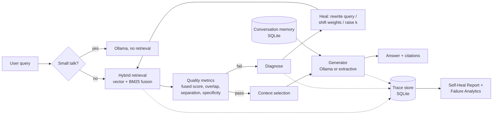

# AdaptiveRAG

[](https://github.com/pravir369/adaptiverag/actions/workflows/ci.yml)
[](LICENSE)

A retrieval-augmented generation (RAG) system that checks its own retrieval before answering, and repairs the query when retrieval looks weak. It runs fully offline: FastAPI + React, SQLite, optional local LLM through Ollama, no API keys.


_Recorded on an Apple M2 with [`vhs`](https://github.com/charmbracelet/vhs); the tape is [`docs/demo.tape`](docs/demo.tape). Everything in it is a live call against a local backend: a paraphrased question answered from the indexed docs, a vague question the self-heal loop repairs, and the offline eval summary._

## The problem

Most RAG pipelines are `embed -> retrieve top k -> generate`. When retrieval misses, nothing notices: the model gets the wrong chunks and answers confidently anyway. The usual culprits are vague questions ("summarize this"), wording that doesn't match the document, and a ranking where the right chunk sits just below the cut.

## What AdaptiveRAG does

1. **Hybrid retrieval.** Vector similarity and BM25 scores are fused with configurable weights.
2. **Retrieval quality checks.** Every attempt is scored on top fused score, query/chunk term overlap, score separation and query specificity.
3. **Diagnosis and repair.** If a check fails, it labels the failure (`QUERY_TOO_VAGUE`, `RETRIEVAL_MISS`, `RANKING_WEAK`, `CHUNK_TOO_COARSE`, `CHUNK_TOO_THIN`), then tries a fix: several query rewrites scored against each other, a lexical/vector weight shift, or a larger k. It keeps the best attempt.
4. **Grounded answers with citations.** A local LLM (Ollama) answers only from the selected chunks, or a deterministic extractive answer is used when no LLM is available.
5. **Traces for every query.** Each attempt, diagnosis, rewrite score and metric delta is stored, and the UI shows it as a Self-Heal Report plus a failure analytics dashboard.

## Architecture



## Quick start

Needs Python 3.11+ and Node 18+. Ollama is optional.

```bash
# backend
cd backend
python -m venv .venv && source .venv/bin/activate
pip install -r requirements.txt
cp .env.example .env
uvicorn app.main:app --reload --port 8000
```

```bash
# frontend, in a second terminal
cd frontend
npm install
npm run dev
```

Open http://localhost:5173, ingest a `.txt`, `.md` or `.json` file, and ask a question. Or try it from the terminal:

```bash
curl -F file=@backend/eval/corpus/shutil.rmtree.txt localhost:8000/api/ingest/upload
curl -X POST localhost:8000/api/chat -H 'content-type: application/json' \
     -d '{"query": "How do I delete a directory and everything inside it?"}'
```

**With a local LLM:** install [Ollama](https://ollama.com/download), run `ollama pull llama3.2:3b` (what the eval and demo above used) or `qwen2.5:3b`, set `GENERATION_PROVIDER=ollama` and `OLLAMA_MODEL` to match in `backend/.env`. If Ollama is unreachable, answers fall back to extractive and the UI says so. Expect 20+ seconds per answer on a CPU-only laptop — see [Answer quality](#answer-quality).

**With semantic embeddings:** `pip install sentence-transformers` and set `EMBEDDING_PROVIDER=sbert` in `backend/.env`. The model (`all-MiniLM-L6-v2`, ~90 MB) downloads on first use; after that it runs offline. This is worth doing — see [Retrieval](#retrieval).

`./start.sh` starts Ollama (if installed), the backend and the frontend together.

## Results

Measured with the offline eval in [`backend/eval/`](backend/eval/), which anyone can rerun.

**Setup.** 33 documents (Python standard-library docstrings for functions like `json.dumps`, `shutil.rmtree`, `subprocess.run`; 40 chunks) and 42 hand-written questions: 28 paraphrased so they share few words with the answer, 14 that use the doc's own terms. Hit@k means the right document is among the first k distinct documents retrieved. top_k=12. Latency is retrieval only, in process.

**Hardware.** Every number below was measured on one machine: Apple M2 (8 cores), 16 GB RAM, macOS 27.0.1, Python 3.14.6, CPU only. Semantic embeddings are `sentence-transformers/all-MiniLM-L6-v2`; the local LLM is `llama3.2:3b` through Ollama.

### Retrieval

| Retrieval | Hit@1 | Hit@5 | MRR@10 | Hit@1, paraphrased only | p50 latency |
|---|---|---|---|---|---|
| BM25 only | 0.76 | 0.95 | 0.84 | 0.68 | 1.0 ms |
| Vector only (hash embeddings) | 0.52 | 0.88 | 0.66 | 0.50 | 3.6 ms |
| Hybrid, no self-heal (hash) | 0.76 | 0.91 | 0.83 | 0.71 | 3.5 ms |
| Hybrid + self-heal (hash, full pipeline) | 0.76 | 0.91 | 0.83 | 0.71 | 3.8 ms |
| Vector only (sentence-transformers) | 0.98 | 1.00 | 0.98 | 0.96 | 116 ms |
| Hybrid, no self-heal (sentence-transformers) | 0.95 | 1.00 | 0.97 | 0.93 | 117 ms |
| **Hybrid + self-heal, sentence-transformers** | **0.95** | **1.00** | **0.97** | **0.93** | **118 ms** |

### Answer quality

Same retrieval (hybrid + self-heal, sentence-transformers), two generators. "Answer match" is a strict substring check: does the generated answer contain the expected phrase?

| Generator | Answer match | p50 answer latency | p95 answer latency |
|---|---|---|---|
| Extractive (no LLM) | 0.64 | 1 ms | 4 ms |
| Ollama `llama3.2:3b` | 0.62 | 21.6 s | 41.4 s |

Reproduce:

```bash
cd backend && pip install -r requirements-dev.txt
python eval/run_eval.py                                              # hash embeddings
pip install sentence-transformers
EMBEDDING_PROVIDER=sbert python eval/run_eval.py                     # semantic embeddings
EMBEDDING_PROVIDER=sbert OLLAMA_MODEL=llama3.2:3b \
  python eval/run_eval.py --generator ollama                         # + local LLM answers
```

Results land in `eval/results/stdlib_hash.json`, `stdlib_sbert.json` and `stdlib_sbert_ollama.json`, with a Markdown table beside each.

**What these numbers say, honestly:**

- **Semantic embeddings are the whole story on this corpus.** Swapping hash embeddings for MiniLM moves Hit@1 from 0.76 to 0.95 and the paraphrased column from 0.71 to 0.93. The earlier claim that "real semantic embeddings are what should lift the paraphrased column" was right, and the size of the lift is larger than expected.
- **Hybrid is now slightly *worse* than vector alone** (0.95 vs 0.98 Hit@1; one question). The fusion weights (`HYBRID_W_VEC=0.7`, `HYBRID_W_LEX=0.3`) were hand-set when the vector side was a lexical hash, so BM25 is being given a say it no longer earns. Weights should be tuned per embedding provider; they are not.
- **Self-heal still never fires on the scored questions** (0 of 42, unchanged). They are specific enough to pass every quality check, so on this set the full pipeline is exactly plain hybrid. It fires on 2 of 3 vague queries. Whether repair actually *improves* an answer is still unmeasured — that needs a labelled set of vague and mismatched questions, and it is the next eval to build. **Do not read the table above as evidence that self-heal works.**
- **The answer-match number does not measure LLM quality.** The local LLM scores 0.62 against the extractive generator's 0.64, but a substring check rewards copying the source wording, which is exactly what the extractive generator does and what a good LLM answer avoids. Spot-checking the per-question output, the LLM answers are clearly better prose and correctly grounded; the metric cannot see that. An LLM-judged faithfulness score is the honest next step.
- **A local LLM costs 20+ seconds per answer on this hardware.** p50 is 21.6 s and p95 is 41.4 s for a 3B model on an M2 CPU, against ~118 ms for retrieval. Retrieval latency itself also rose to 734 ms p50 during the Ollama run, with the model resident on the same machine. Anything interactive needs a smaller context, a smaller model, or a GPU.
- **Semantic retrieval is ~30x slower than hash** (118 ms vs 3.8 ms p50), all of it CPU-side query embedding. Fine at this corpus size, worth batching or caching later.

Full per-question output, including every generated answer: [`stdlib_hash.json`](backend/eval/results/stdlib_hash.json), [`stdlib_sbert.json`](backend/eval/results/stdlib_sbert.json), [`stdlib_sbert_ollama.json`](backend/eval/results/stdlib_sbert_ollama.json). CI reruns the hash eval on every push and posts the table in the job summary.

### Bugs the eval caught

The first run scored vector-only at Hit@1 0.07, barely above picking one of 33 documents at random (0.03). The hash embedding mixed each word's *position* into its bucket, so "json" in a short query and "json" deep in a document landed in different buckets. It also weighted short words like "how" and "do" above longer, more meaningful ones. Fixing both:

| | Hit@1 before | Hit@1 after |
|---|---|---|
| Vector only | 0.07 | 0.52 |
| Hybrid | 0.19 | 0.76 |

Indexes built before the fix need a re-ingest (delete `backend/data/` and upload again).

A second bug surfaced the first time the semantic path was actually run: `SBERTEmbeddingProvider.embed_texts` passed a `dtype=` keyword to `SentenceTransformer.encode()`, which sentence-transformers 5.x rejects, so `EMBEDDING_PROVIDER=sbert` raised on the first ingest and fell back to hash embeddings. No test covered it, because the test suite and CI only exercised the default hash provider. Fixed, and [`tests/test_embeddings_sbert.py`](backend/tests/test_embeddings_sbert.py) now covers the provider against a stub that reproduces the sentence-transformers 5.x `encode()` contract, so the regression is caught in CI without installing torch. The same file runs the real model when it happens to be installed.

## Known limitations and next steps

- Hybrid candidates come from the vector search only; BM25 rescores them but can't add a chunk the vector side missed. On larger corpora the candidate set should be the union of both.
- The corpus is small and the questions were written for this eval. Next: a public docs set with 100+ questions, and an LLM-judged answer-faithfulness score spot-checked by hand.
- Thresholds and fusion weights are hand-set defaults, not tuned, and the defaults predate semantic embeddings (see the hybrid-vs-vector note above).
- CI covers the sentence-transformers provider only against a stub of the library's contract, and does not exercise the real model or the Ollama generator at all, so regressions there still surface only when someone runs them by hand.

## Tests

```bash
cd backend
pip install -r requirements-dev.txt
python -m pytest -q
```

Covers hash embeddings (including a regression test for the position bug), the sentence-transformers provider (against a stub of the library's `encode()` contract, plus the real model when it is installed), chunking, the self-heal loop on a vague query, and the HTTP API end to end (ingest, chat with citations, trace, conversation memory). CI runs tests and the eval on Python 3.11 and 3.12 and builds the frontend.

## API

| Method | Endpoint | Description |
|--------|----------|-------------|
| `POST` | `/api/chat` | RAG query with conversation memory |
| `GET` | `/api/conversations` | List conversations |
| `GET` | `/api/conversations/:id` | Conversation with messages |
| `DELETE` | `/api/conversations/:id` | Delete a conversation |
| `POST` | `/api/ingest/upload` | Upload and index a document |
| `POST` | `/api/ingest/url` | Fetch and index a URL |
| `GET` | `/api/docs` | List indexed documents |
| `GET` | `/api/trace/:id` | Full retrieval trace |
| `GET` | `/api/analytics/failures` | Failure analytics |
| `GET` | `/api/health` | Health check |

## Configuration

Set in `backend/.env` (see `.env.example`):

```bash
EMBEDDING_PROVIDER=hash        # hash (default, offline) or sbert (needs sentence-transformers)
GENERATION_PROVIDER=extractive # extractive (default) or ollama
OLLAMA_MODEL=qwen2.5:3b        # llama3.2:3b is what the eval and demo above used
OLLAMA_BASE_URL=http://localhost:11434
HYBRID_W_VEC=0.7               # fusion weights
HYBRID_W_LEX=0.3
MAX_SELF_HEAL_ATTEMPTS=3
```

PDF upload works after `pip install pypdf`.

## Project structure

```
backend/
  app/
    api/routes.py          REST endpoints, conversation handling, small-talk routing
    rag/retriever.py       hybrid retrieval, self-heal loop, context selection
    rag/metrics.py         retrieval quality metrics
    rag/diagnose.py        failure diagnosis
    rag/heal.py            query rewrites, weight and k adjustments
    rag/hybrid_lexical.py  BM25 index
    rag/index.py           NumPy vector index
    rag/embeddings/        hash and sentence-transformers embeddings
    rag/generator/         extractive and Ollama generators, citation extraction
    ingest/                file upload and URL ingestion
    trace/store.py         trace persistence
  eval/                    offline eval: corpus, questions, runner, results
  tests/                   pytest suite
frontend/src/pages/        Chat, Ingest, Docs, Trace, Self-Heal Report, Failure Analytics
```

## License

[MIT](LICENSE)
